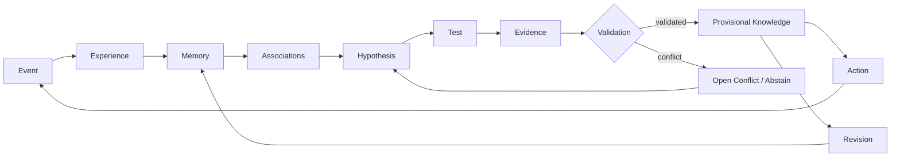
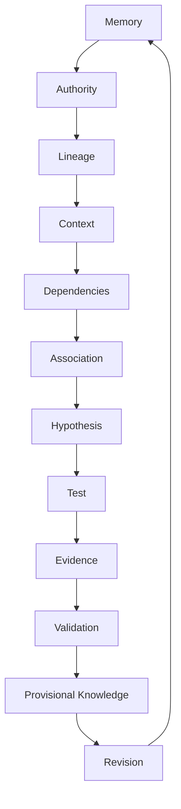

# ARI — Public Architecture v0.1

## Core flow



## Governed knowledge lifecycle



## Conflict behavior

```text
Equal contradictory authority  -> OPEN_CONFLICT / ABSTAIN
Stronger validated authority    -> SUPERSEDE, preserving lineage
Weaker incoming evidence        -> KEEP_CURRENT_AUTHORITY, preserve evidence
```

## Design objective

ARI's memory layer should eventually represent each meaningful relationship with:

```text
Relation
├── type
├── source / provenance
├── created_at
├── supporting_experiences[]
├── confidence
├── authority
├── validation_state
├── dependencies[]
├── contradictions[]
└── supersession_history[]
```

This document is conceptual. It is not a description of the private ALPHA implementation.
